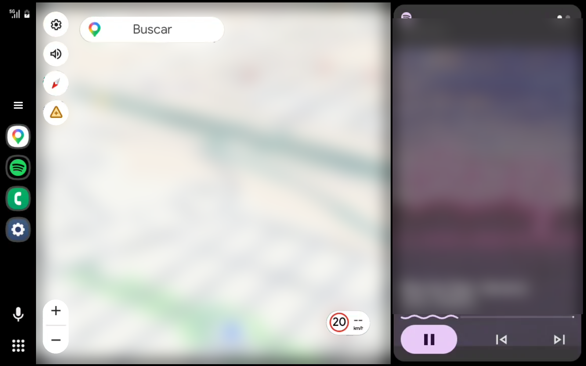

# MyCarDisplay

> 🚧 **En desarrollo activo** · Nombre provisional · Proyecto personal sin afiliación con Google.


Una app Android que convierte una **tablet en la pantalla del coche**: la tablet actúa
como receptor y muestra Android Auto proyectado desde el móvil (Google Maps, música y
asistente) por una conexión Wi-Fi local, con táctil y micrófono.

Además de un producto, MyCarDisplay es mi **laboratorio para aprender a desarrollar
con agentes de IA de forma profesional**: lo construyo para ganar experiencia real con
flujos agénticos y consolidar conocimientos nuevos (Android a bajo nivel, vídeo,
protocolos y TLS) en un problema técnico exigente.

El código aún no es público: este repositorio documenta el proyecto y su avance.



*Mi receptor en Kotlin (versión de depuración) mostrando Android Auto a pantalla
completa y con la distribución original, proyectado desde el móvil real. Se maneja
desde la tablet: toques, desplazamiento y zoom con dos dedos. El botón de menú sobre
el icono de Maps es mío y abre los controles del receptor. El mapa, la música y la
hora están difuminados por privacidad. Android Auto, Google Maps y Spotify son marcas
de sus titulares; proyecto personal sin afiliación.*

## Cómo nació

Mi coche es antiguo: no tiene pantalla ni navegador. Tenía una tablet vieja y se me
ocurrió darle una segunda vida como **la pantalla de un coche moderno**:
Google Maps, música y asistente en el salpicadero, controlados desde la tablet, sin
cambiar la radio ni comprar hardware: todo el sonido sigue saliendo por la radio
del coche, conectada al móvil por Bluetooth.

Las soluciones existentes dependen de hardware adicional o de configuraciones
frágiles. Primero monté un sistema propio basado en proyectos de la comunidad, que
uso a diario. Ahora construyo uno nuevo con **arquitectura y código propios**,
usando aquel sistema solo como referencia de lo que funciona.

## Arquitectura

```
┌──────────────────────┐   Wi-Fi local (hotspot del móvil)   ┌──────────────────────┐
│  Móvil               │ ──────────────────────────────────▶ │  Tablet Receiver     │
│  Android Auto        │   protocolo de proyección sobre TLS │  protocolo propio en │
│  (Maps, música,      │ ◀────────────────────────────────── │  Kotlin: vídeo,      │
│  asistente)          │   vídeo · táctil · micrófono        │  táctil, micrófono   │
└──────────────────────┘                                     └──────────────────────┘
```

- **Fase 1 — receptor en la tablet:** la capa de protocolo se escribe en Kotlin, canal
  por canal (vídeo, táctil, micrófono, sensores, estado).
- **Fase 2 — arranque automático desde el móvil:** al conectar el Bluetooth del coche,
  preparar la red y la sesión sin tocar el móvil.
- **Audio:** todo el sonido sale del móvil por el Bluetooth de la radio del coche, como
  siempre: música, indicaciones de navegación, llamadas, lectura de mensajes y sonidos
  del sistema. La tablet no reproduce audio; solo envía el micrófono para el asistente.
- Núcleo de sesión compartido con colas acotadas y máquinas de estado explícitas.

## Cómo lo desarrollo: agentes de IA con método

Trabajo con agentes de IA sobre **Pi** +
[**Gentle Shell**](https://github.com/Gentleman-Programming/gentle-shell) y
[**Gentle AI**](https://github.com/Gentleman-Programming/gentle-ai). Los agentes
ejecutan; yo decido el alcance, apruebo cada unidad de trabajo y nada entra sin tests.

| Práctica | Qué significa en este proyecto |
|---|---|
| **Spec-Driven Development (SDD)** | El MVP y un RFC con la matriz de comportamiento se aprueban antes de escribir código de producto; cada cambio de rumbo se registra como enmienda. |
| **Organic Driven Development (ODD)** | El trabajo grande se divide en unidades pequeñas (~400 líneas), cada una con sus tests, su documentación y su commit. |
| **Receipt-Driven Development (RDD)** | Cada cambio pasa una revisión independiente antes del commit. |
| **Memoria persistente** | [Engram](https://github.com/Gentleman-Programming/engram) conserva decisiones y contexto entre sesiones. |
| **Test-first** | Cada unidad empieza con un test que falla (RED) sobre el comportamiento real. |
| **Diagnóstico con dispositivos reales** | El agente opera `adb` con permisos por niveles que yo autorizo, captura logs acotados y compara nuestras sesiones con un sistema de referencia que ya funciona. |

Lo que estoy aprendiendo: delegar sin perder el control, verificar de forma independiente
lo que produce un agente, y escribir alcances lo bastante precisos para que un agente
no se desvíe.

## Ingeniería destacada

- **Diagnóstico en lugar de prueba y error:** formato de log versionado (V1→V4) con
  lector estricto en Python y *goldens* generados por el emisor Kotlin real,
  verificados en ambos lenguajes.
- **Sonda de protocolo propia:** una herramienta en Python que habla con el móvil real
  (negociación de versión, TLS y descubrimiento de servicios) y atribuye cada fallo a
  su fase con tiempos medidos.
- **Comparación contra una referencia:** capturas acotadas de una sesión que funciona
  y de la nuestra, para localizar exactamente dónde se separan.
- **Límites explícitos:** colas, plazos y presupuestos de memoria acotados y testeados.
- **Lo que los tests no ven:** la primera prueba real falló por una API de Java que la
  tablet (Android 12) no tiene y que los tests en el PC no podían detectar. Ahora un
  control de lint bloquea esas llamadas antes de compilar.
- **Revisión que ve lo que la prueba no ve:** el micrófono ya funcionaba con el
  asistente, pero la revisión independiente encontró un caso en el que el móvil
  recibiría solo silencio, el mismo fallo que rompía el asistente en el sistema de
  referencia. Se corrigió con un test antes de integrarlo.
- **Base de conocimiento verificada:** todo lo aprendido sobre el protocolo, los
  dispositivos y el sistema de referencia está en un documento propio; dos agentes
  independientes contrastaron cada afirmación con su fuente antes de darlo por bueno.
- **Procedencia y privacidad:** registro del origen de cada material externo; ningún
  dato personal ni de dispositivos en la evidencia.

## Estado

| Área | Estado |
|---|---|
| MVP y RFC (incluida la enmienda del receptor propio) | ✅ Aprobados |
| Núcleo de sesión | ✅ Implementado y testeado |
| Decodificador de vídeo en la tablet | ✅ Implementado y testeado |
| Handshake entre móvil y tablet (laboratorio) | ✅ Funciona en dispositivos reales |
| Sonda de protocolo contra el móvil real | ✅ Sesión completa: el móvil abre todos los canales y envía vídeo H.264 |
| Arquitectura del receptor (RFC 0003) | ✅ Aprobada; se implementa por etapas |
| Receptor propio en Kotlin: vídeo en la tablet | ✅ Muestra Android Auto proyectado desde el móvil real: primer fotograma en 6,6 s y una sesión de 27 minutos sin perder fotogramas |
| Táctil | ✅ Toques, desplazamiento y zoom con dos dedos sobre Android Auto, a pantalla completa con la distribución original |
| Micrófono (para el asistente) | ✅ El asistente de Google entiende la voz desde la tablet: busca una gasolinera, pregunta a cuál ir y traza la ruta en Maps; también cambia de canción en Spotify |
| Ciclo de vida (volver desde Inicio, pantalla apagada) | ⏳ Siguiente paso |
| Arranque automático desde el móvil | ⏳ Pendiente (fase 2) |

## Roadmap

- [x] Diseño del MVP y RFC
- [x] Núcleo de sesión con colas acotadas
- [x] Handshake de laboratorio entre dispositivos
- [x] Sonda de protocolo: versión, TLS y descubrimiento
- [x] Calibración contra un sistema de referencia que funciona
- [x] El móvil acepta la sesión y abre todos los canales
- [x] Primer vídeo recibido del móvil en nuestro receptor de pruebas
- [x] RFC 0003: arquitectura del receptor en Kotlin
- [x] Vídeo visible de extremo a extremo con nuestro receptor en Kotlin
- [x] Táctil y pantalla completa con nuestro receptor en Kotlin
- [x] Micrófono para el asistente con nuestro receptor en Kotlin
- [ ] Ciclo de vida: volver desde Inicio o con la pantalla apagada sin reiniciar la sesión
- [ ] Arranque automático desde el móvil (fase 2)
- [ ] Publicación del código (pendiente de revisión de licencias y procedencia)

## Stack

Kotlin · Android (MediaCodec, EGL, redes locales) · Gradle · Python · adb ·
Pi · Gentle Shell · Gentle AI · Engram

## Autor

**Santiago Castillo** · Desarrollo de Aplicaciones Multiplataforma · Madrid
[GitHub](https://github.com/santi-cast) · Buscando empresa para la formación en empresa del DAM
